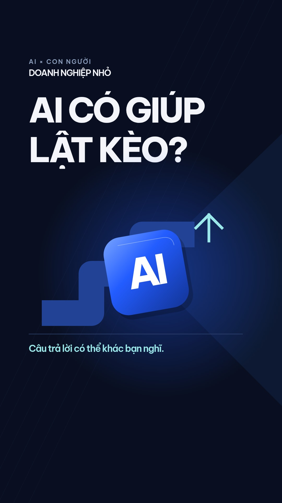

# AI — lợi thế nằm ở cách dùng

[**Xem hoặc tải video**](https://raw.githubusercontent.com/chienguyen276/video-uot-ra/main/ai-cach-minh-dung.mp4)

Video dọc Full HD · 1080 × 1920 · 30 fps · 1 phút 26 giây.

Biên tập từ bài viết người dùng cung cấp, với 14 cảnh motion graphic, chữ bám lời, nhạc điện tử nguyên bản ở 116 BPM và hiệu ứng chuyển cảnh. Cảnh khách hàng mệt mỏi giảm nhạc để nhấn việc lắng nghe và thấu hiểu.

Có sử dụng ảnh diễn giả do người dùng cung cấp, được tách nền và bố cục lại. Lời đọc được tạo mới bằng giọng tổng hợp; đây không phải bản thu phát biểu của diễn giả tại CICON.

- [Mã nguồn để chỉnh sửa và xuất lại](https://raw.githubusercontent.com/chienguyen276/video-uot-ra/main/ai-cicon-2026-source.zip)
- [Phụ đề tiếng Việt](https://github.com/chienguyen276/video-uot-ra/blob/main/ai-cach-minh-dung.vi.srt)

