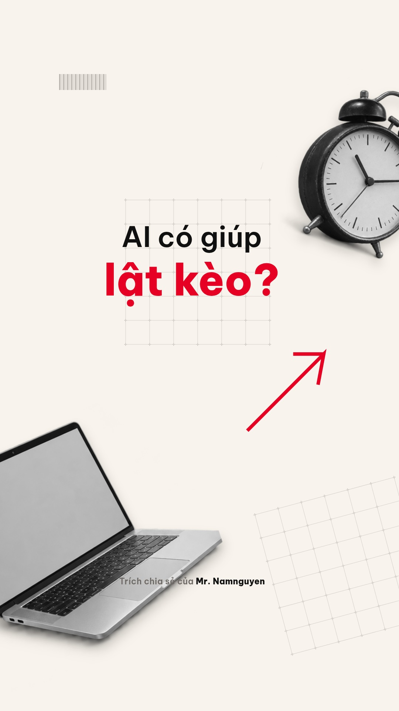

# AI — Cách mình dùng / bản dựng v2

[**Xem hoặc tải video v2**](https://raw.githubusercontent.com/chienguyen276/video-uot-ra/main/ai-namnguyen-motion-v2.mp4)

Trích nội dung chia sẻ của **Mr. Namnguyen**, theo thông tin người dùng cung cấp.

Dọc Full HD · 1080×1920 · 30 fps · khoảng 1 phút 18 giây.

Bản v2 dựng lại theo phong cách video tham khảo: ảnh cắt ghép đen trắng, nền kem–đen, chữ nhấn đỏ theo cụm lời, zoom nhấn và các lần quét hình. Lời đọc nhanh hơn 10% và giữ cao độ; nhạc mới 124 BPM, thêm tiếng lướt, va chạm, gõ chữ, giấy và đồng hồ theo chuyển động.

Lời dẫn là giọng tổng hợp biên tập, không phải bản thu phát biểu hoặc giọng mô phỏng của Mr. Namnguyen. Không dùng lại hình, nhạc hay tiếng nói trong video mẫu.

- [Mã nguồn để xuất lại](https://raw.githubusercontent.com/chienguyen276/video-uot-ra/main/ai-namnguyen-v2-source.zip)
- [Phụ đề](https://github.com/chienguyen276/video-uot-ra/blob/main/ai-namnguyen-v2.vi.srt)
- [Bản trước để so sánh](https://github.com/chienguyen276/video-uot-ra/blob/main/ai-cach-minh-dung.mp4)

