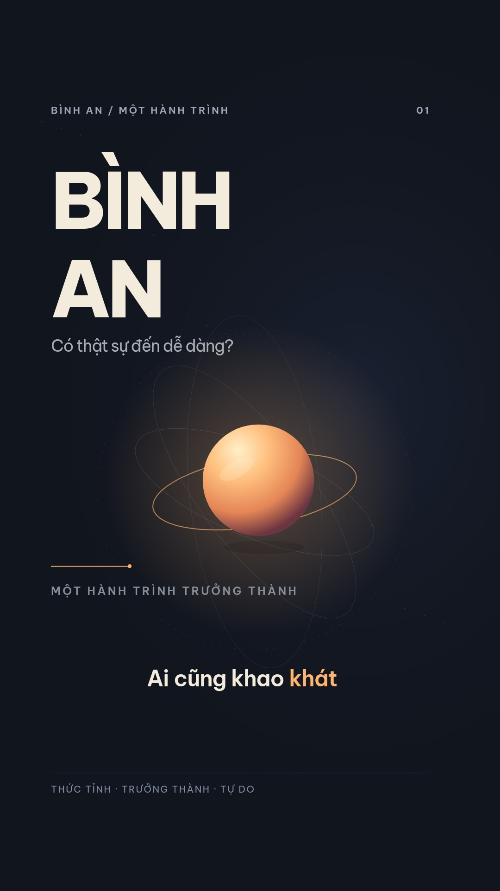

# Bình an — bản motion graphic mới

[Xem hoặc tải video Full HD](https://raw.githubusercontent.com/chienguyen276/video-uot-ra/main/binh-an-motion-graphic-v2.mp4)

1080 × 1920 · 30 fps · 2 phút 02 giây · H.264 / AAC stereo.

Biên tập từ nội dung video được cung cấp, dựng thành 11 cảnh đồ họa mới. Không sử dụng ảnh, cảnh quay hay âm thanh trong video cũ. Lời đọc tiếng Việt tổng hợp mới; nhạc piano/dây được soạn riêng, kết hợp hiệu ứng chuyển cảnh và chữ bám lời.

- [Mã nguồn có thể kết xuất lại](https://github.com/chienguyen276/video-uot-ra/raw/refs/heads/main/binh-an-source-v2.zip)
- [Phụ đề tiếng Việt](https://github.com/chienguyen276/video-uot-ra/blob/main/binh-an.vi.srt)
- [Bản dựng trước](https://github.com/chienguyen276/video-uot-ra/blob/main/motion-graphic.mp4)

