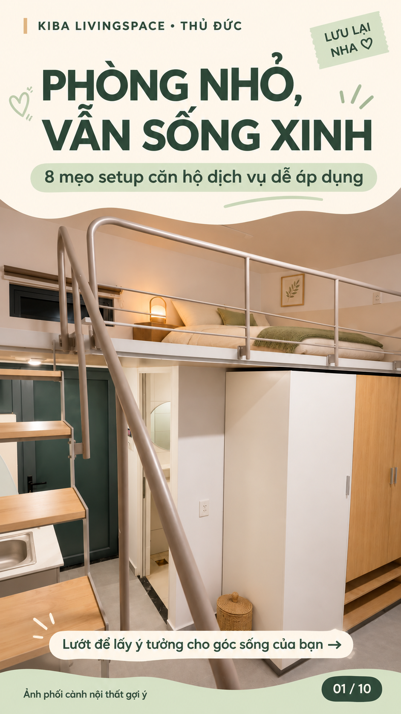
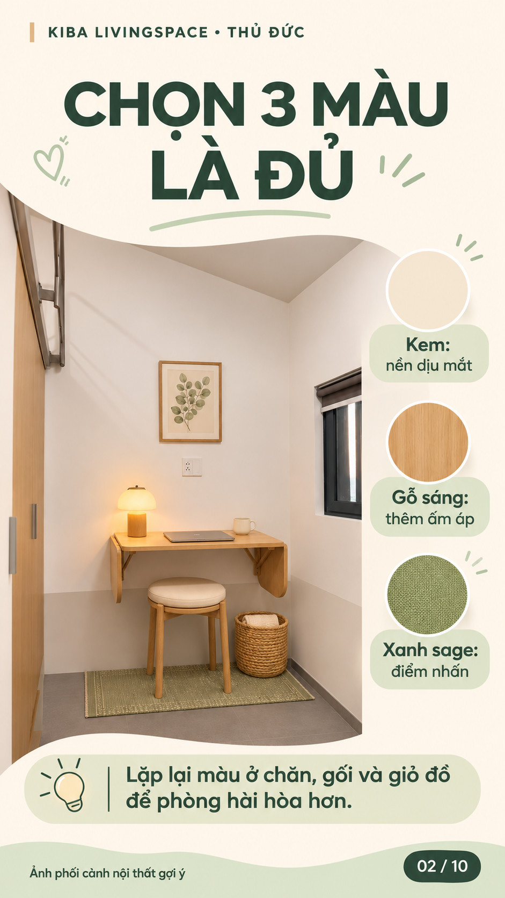
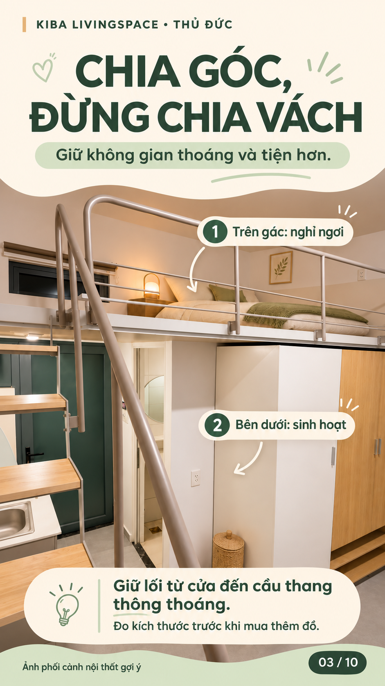
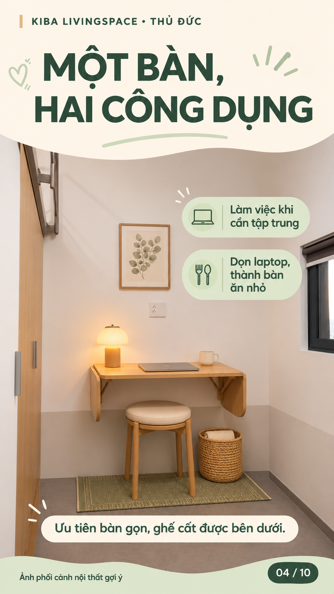
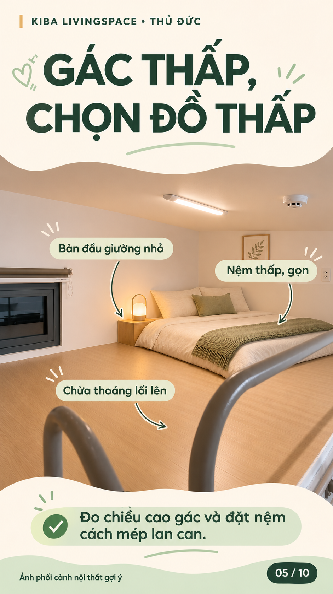
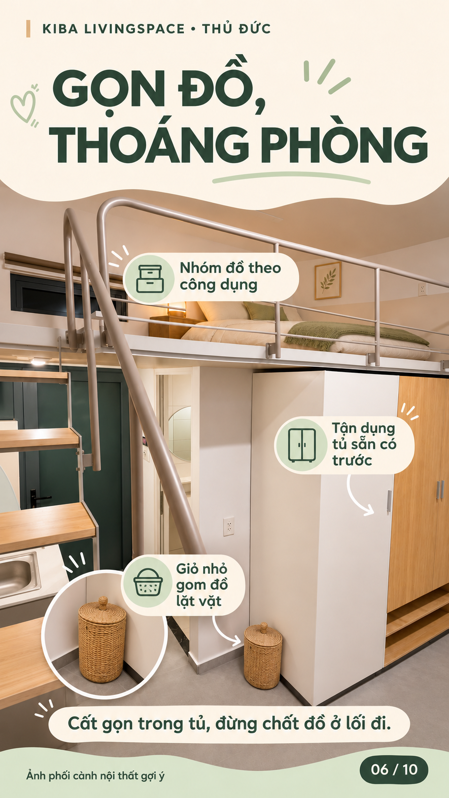
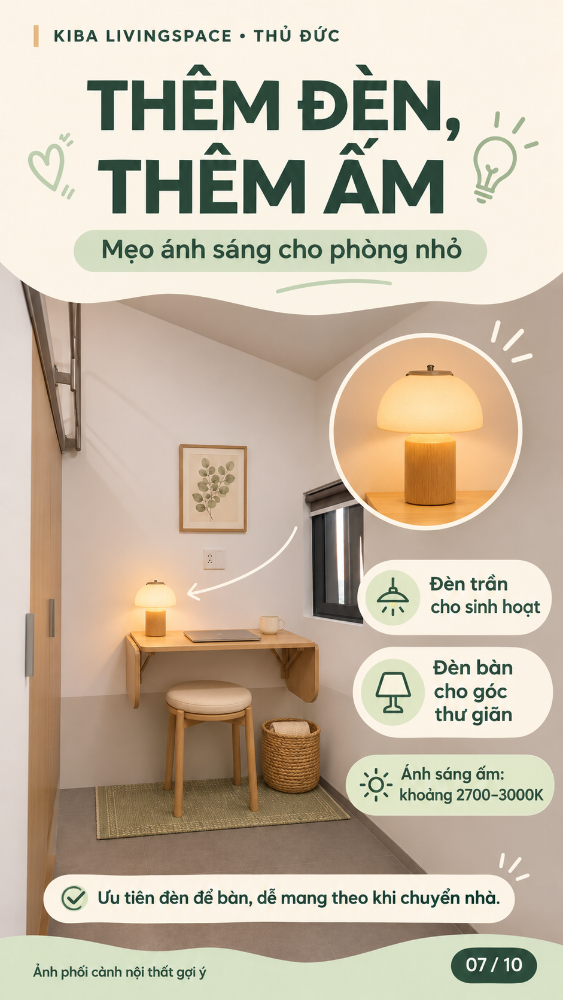
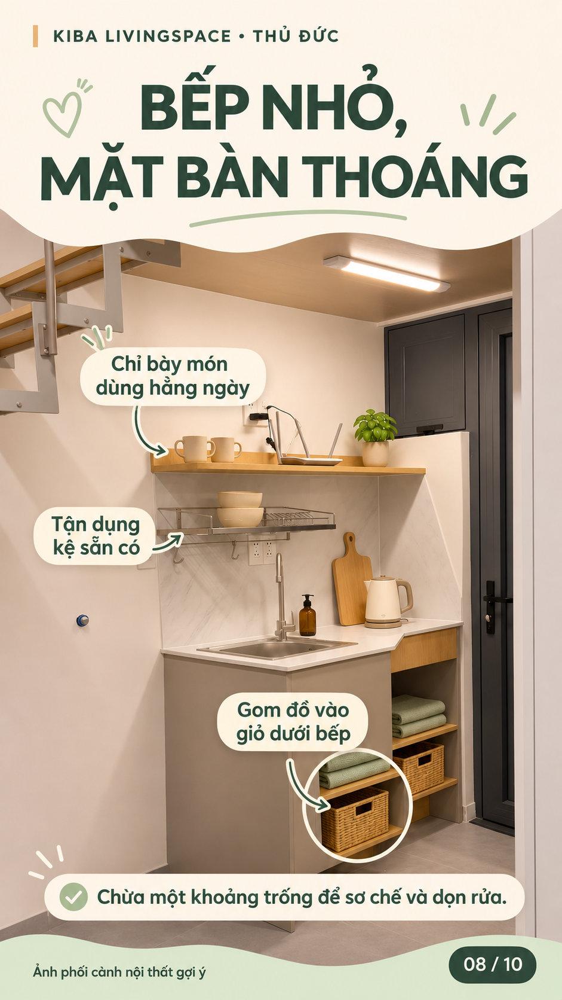
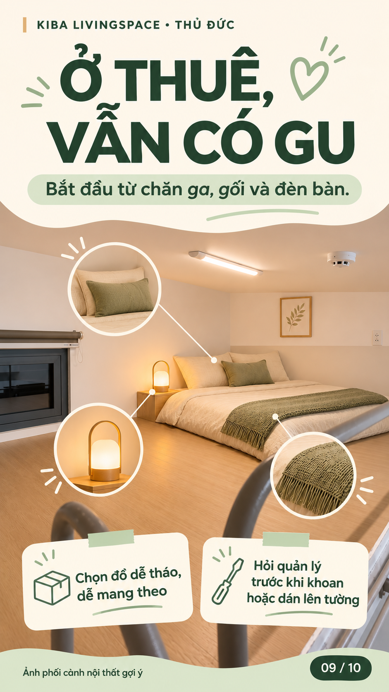
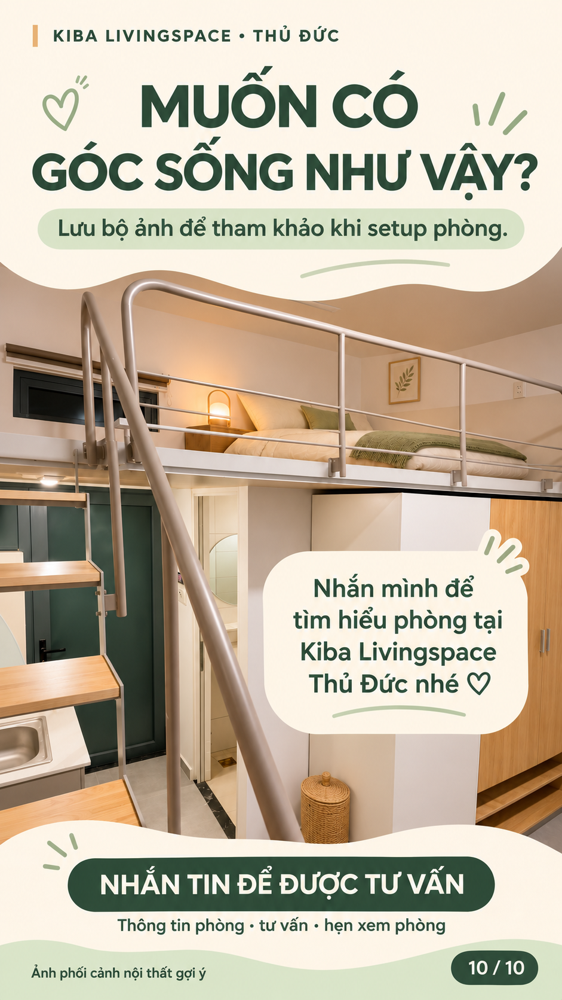

# Phòng nhỏ, vẫn sống xinh — 10 ảnh TikTok

Bộ ảnh chia sẻ 8 mẹo setup căn hộ dịch vụ, dùng phòng Kiba Livingspace Thủ Đức làm ví dụ. Có bìa và ảnh kết mời nhắn tin. Đăng ảnh theo thứ tự 01–10.

[Tải cả bộ ảnh PNG và caption](kiba-setup-10-anh.zip)

Ảnh được tạo bằng AI từ các phối cảnh phòng đã có. Đây là ý tưởng setup, không xác nhận nội thất đã được trang bị trong phòng. Nhãn phối cảnh có trên từng ảnh.

### 01-bia-phong-nho-song-xinh

### 02-chon-bang-mau

### 03-chia-khu-sinh-hoat

### 04-ban-hai-cong-dung

### 05-gac-ngu-thoang

### 06-luu-tru-gon

### 07-anh-sang-am

### 08-bep-thoang

### 09-do-de-mang-theo

### 10-nhan-tin-kiba

